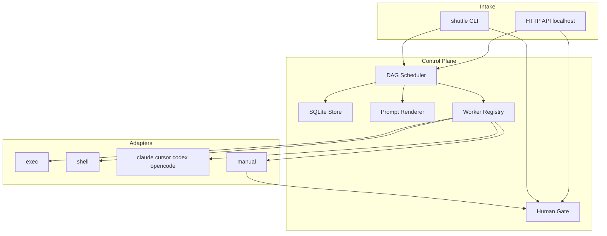

# shuttle — AI Software Factory Control Plane

**Name / CLI / config / data / repo:** all `shuttle`.

**Go module:** `github.com/savitharaghunathan/shuttle`

**Implementation plan:** [docs/plan/2026-08-25-shuttle.md](docs/plan/2026-08-25-shuttle.md) · **Design copy:** [docs/plan/design.md](docs/plan/design.md)

## MVP checklist

- [ ] Go module, `cmd/shuttle`, single SQLite at `.shuttle/shuttle.db`, git remote
- [ ] YAML load, DAG validate, ready-set scheduler, retries/timeouts, cancel
- [ ] Run workspace; intake copy; prompt render; artifact I/O contract
- [ ] `shell` + `exec` workers; vendor presets as argv templates
- [ ] `manual` stage; `waiting_approval`; approve/reject CLI + API
- [ ] Embed `pr-factory` + `sdlc` with locked stage defaults and gates
- [ ] CLI first; HTTP serve localhost-only wrapping same engine
- [ ] Unit tests for DAG, ready-set, scheduler+fake worker, gate, cancel
- [ ] Dry-run: intake → stub → test → approve → open_pr
- [ ] Origin `git@github.com:savitharaghunathan/shuttle.git`; push when asked

## Decisions (locked)

- **Name:** `shuttle` everywhere
- **Language:** Go (single binary)
- **State:** one SQLite DB at `{work_root}/shuttle.db` (default `.shuttle/shuttle.db`); single-writer only in v0
- **Workers:** agnostic interface; no vendor SDKs in core
- **Human gates:** `manual` stages from day one before `open_pr` / `ship`
- **One engine:** CLI `run` and HTTP `serve` share the same scheduler
- **No run resume:** failed/cancelled/rejected runs are terminal; no `shuttle retry` in v0 (stage-level `retries` only)
- **HTTP serve:** bind `127.0.0.1` by default; no auth in v0
- **Ship / open_pr / test:** see [Stage defaults](#stage-defaults-v0)
- **Retries/timeouts/cancel:** implemented in v0; schema matches behavior
- **Tests:** required for DAG + scheduler + gates + cancel
- **Trust:** stages run as invoking user; README states trust boundary
- **Git commits:** `git commit -s` (Signed-off-by) plus body line `Assisted-by: Cursor <cursoragent@cursor.com>`. Do **not** use `--trailer "Co-authored-by: ..."`. Not `-S` GPG/SSH.

## Architecture



## Run workspace

**Store:** single file `.shuttle/shuttle.db` (all runs).  
**Per-run dir:**

```
.shuttle/runs/<run-id>/
  meta.json
  inputs/            # e.g. spec.md from --spec
  artifacts/         # stage outputs by name
  logs/<stage-id>.log
  approvals/         # approve/reject messages
```

**Code target (v0):**

- Caller’s **`cwd`** is the project agents/shell mutate
- Run dir holds shuttle metadata/artifacts/logs only — not a full clone
- Optional later: `repo_url` + clone/worktree (out of v0; schema may reserve unused field)

## Prompt and artifact contract

Stages declare inputs/outputs; the engine renders prompts before dispatch.

**Render context** (Go `text/template`):

```go
type RenderContext struct {
    RunID     string
    StageID   string
    Inputs    map[string]string
    Artifacts map[string]string // name -> absolute path
    Cwd       string
    RunDir    string
    Env       map[string]string
}
```

**Rules:**

- Missing required upstream artifact → stage fails with a clear error
- Worker `Result.Outputs` maps artifact name → path relative to `artifacts/`; engine validates declared `outputs`
- `shell` / `exec` use the same templates for command strings

## Stage defaults (v0)

Locked behavior for embedded templates (overridable via `shuttle.yaml` / pipeline overlay).

### Intake

- **Worker:** built-in `intake` (or `shell` equivalent) — not an agent
- **Behavior:** require `--spec <path>`; copy file to `inputs/spec.md` and `artifacts/spec` (same content)
- **Fail** if `--spec` missing or unreadable

### Agent stages (`implement`, `plan`, `design`, `review`)

- **Worker:** `default_worker` from config (e.g. `claude`)
- **Prompt:** embedded template string using `{{.Artifacts.spec}}` / prior artifacts and `{{.Cwd}}`
- **Outputs:** at least `summary` (worker or wrapper writes `artifacts/summary`)
- Stages may override `worker:` or `command:` in YAML when needed

### `test`

- **Worker:** `shell`
- **Default command:** `go test ./...`
- Override: `test.command` in `shuttle.yaml` (string or argv list)

### `open_pr`

- **Worker:** `shell`
- **Default command (safe):** `echo "open_pr skipped: configure open_pr.command (e.g. gh pr create --fill)"` (exit 0)
- **Documented production override:** `gh pr create --fill` (or equivalent) in `shuttle.yaml`
- Always behind `approve_pr`

### `ship`

- **Worker:** `shell`
- **Default command (safe):** `echo "ship skipped: configure ship.command"` (exit 0)
- Not auto-merge unless user configures it
- Always behind `approve_ship`

## Workers

### Interface

```go
type Request struct {
    RunID, StageID string
    WorkDir        string
    RunDir         string
    Prompt         string
    Command        []string
    Env            map[string]string
    Timeout        time.Duration
}

type Result struct {
    Status  Status
    Summary string
    Outputs map[string]string
}

type Worker interface {
    Name() string
    Execute(ctx context.Context, req Request) (Result, error)
}
```

### Config-driven argv (vendor drift defense)

```yaml
default_worker: claude
work_root: .shuttle
concurrency: 2
default_timeout: 30m
test:
  command: ["go", "test", "./..."]
open_pr:
  command: ["echo", "open_pr skipped: configure open_pr.command"]
ship:
  command: ["echo", "ship skipped: configure ship.command"]
workers:
  shell:
    shell: /bin/bash
  claude:
    bin: claude
    args: ["-p", "{{.Prompt}}"]
  codex:
    bin: codex
    args: ["exec", "{{.Prompt}}"]
  opencode:
    bin: opencode
    args: ["run", "{{.Prompt}}"]
  cursor:
    bin: cursor-agent
    args: ["--print", "{{.Prompt}}"]
```

- Override presets via config without code changes
- Missing binary → dispatch error naming worker and expected `bin`
- `exec`: stage YAML supplies full argv when presets don’t fit

### `manual`

Scheduler branch (not a subprocess): ready → `waiting_approval` → approve/reject.

## Human gates

When a `manual` stage is ready:

1. StageRun → `waiting_approval`; Run → `blocked`
2. No auto-dispatch
3. `shuttle approve` / `reject` (or HTTP) with optional `-m`
4. Approve → stage `succeeded`, write `approvals/<stage>.md`, unlock dependents
5. Reject → stage `rejected`, run `failed`, downstream `skipped`

If `stage-id` omitted and exactly one gate is waiting, target it.

Templates always gate before side effects:

- `pr-factory`: `approve_pr` before `open_pr`
- `sdlc`: `approve_ship` before `ship`

## Retries, timeouts, cancel

**Retries / timeouts**

- Stage `retries` (default `0`) and `timeout` (default from config) honored
- Non-manual failure with attempts left → re-queue `ready` after fixed backoff (e.g. 2s)
- Timeout → context cancel → failed attempt
- Manual: no retries; reject is terminal for the run

**Cancel** (`shuttle cancel <run-id>`)

1. Cancel in-flight stage context (kill subprocess when possible)
2. Mark that stage `cancelled` if it was `running`
3. Mark all `pending` / `ready` / `waiting_approval` stages `skipped`
4. Run → `cancelled` (terminal)
5. No resume; start a new run to try again

**No run-level retry in v0** — document explicitly; stage `retries` only.

## Pipeline templates

**`pr-factory`:** `intake` → `implement` → `test` → `approve_pr` → `open_pr`

**`sdlc`:** `plan` → `design` → `implement` → `test` → `review` → `approve_ship` → `ship`

- `plan` / `design` / `review` use same agent-stage defaults as `implement`, with stage-specific embedded prompts
- Overlays under `pipelines/` can add gates or override commands

## Scheduler

- One implementation for `shuttle run` and `shuttle serve`
- `run`: foreground until terminal or `blocked`; print how to approve/reject; `--follow` optional wait on DB wake
- Poll SQLite for `ready` stages; global concurrency limit
- Single-writer SQLite only in v0
- No Redis/NATS

## CLI / API

**CLI (primary):** `run`, `status`, `logs`, `approve`, `reject`, `cancel`, `workers`, `serve`

**HTTP:** thin wrapper — `POST/GET /v1/runs`, cancel, approve/reject, `GET /v1/pipelines`

- Default listen: `127.0.0.1:8080` (not `0.0.0.0`)
- No auth in v0; README warns not to expose
- Implement after CLI works; must not fork scheduler logic

## Trust / security (README)

- `shell`, `exec`, and agent CLIs run with the **invoking user’s privileges**
- Pipeline YAML is executable configuration — only run trusted templates
- Human gates reduce accidental publish/merge; they are not a sandbox
- Localhost-only serve; no multi-tenant auth in v0

## Tests (MVP)

| Test | Asserts |
|------|---------|
| DAG validate | cycle rejected; missing dep rejected; unique ids |
| ready-set | dependents unlock only when all deps succeeded |
| scheduler + fake worker | linear success; failure skips/stops downstream |
| manual gate | block; approve continues; reject fails run |
| prompt render | artifact paths substituted; missing artifact errors |
| cancel | running cancelled; pending skipped; run terminal |
| intake | `--spec` copy lands in artifacts |

## Repo layout

```
cmd/shuttle/main.go
internal/
  api/
  store/
  pipeline/     # load, validate, render, scheduler
  worker/       # shell, exec, presets, intake, manual
  artifact/
  templates/    # embed pr-factory.yaml, sdlc.yaml
pipelines/
shuttle.yaml.example
go.mod          # github.com/savitharaghunathan/shuttle
README.md
```

## Git

- Origin: `git@github.com:savitharaghunathan/shuttle.git`
- Init + push when implementing / when asked

## Implementation order

1. Module + SQLite schema (incl. `blocked`, `waiting_approval`, `cancelled`, retries) + remote
2. YAML load + DAG validate + unit tests
3. Run workspace + intake copy + prompt/artifact renderer + tests
4. Scheduler + `shell` + **manual gate** + **cancel** + fake-worker tests
5. Embed templates with stage defaults; safe `open_pr` / `ship` echoes
6. `exec` + vendor presets via argv config
7. CLI (approve/reject/cancel); then localhost HTTP `serve`
8. E2E dry-run: intake → stub implement → test → approve → open_pr

## Out of scope (later)

- Web dashboard / Canvas UI
- Multi-tenant auth / SSO on approve
- Bind `0.0.0.0` / reverse-proxy auth
- Clone/worktree from `repo_url`
- `shuttle retry` / resume failed runs
- Distributed workers / Redis
- Deep Cursor SDK coupling
- Auto-merge as a built-in
- Slack/email notifications for gates
- Multi-process SQLite writers
